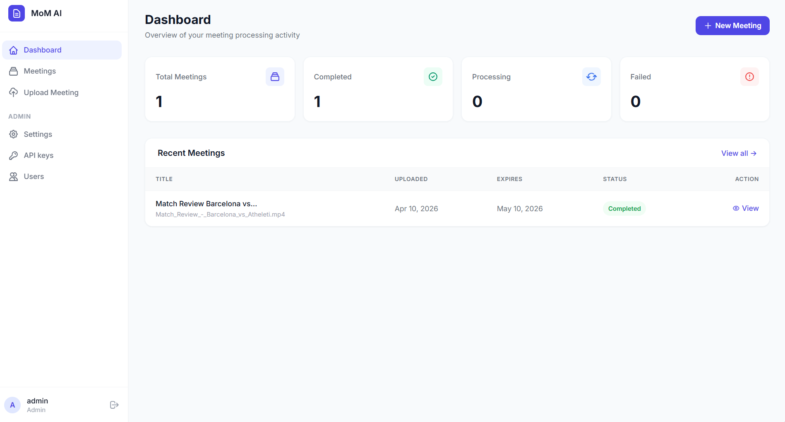
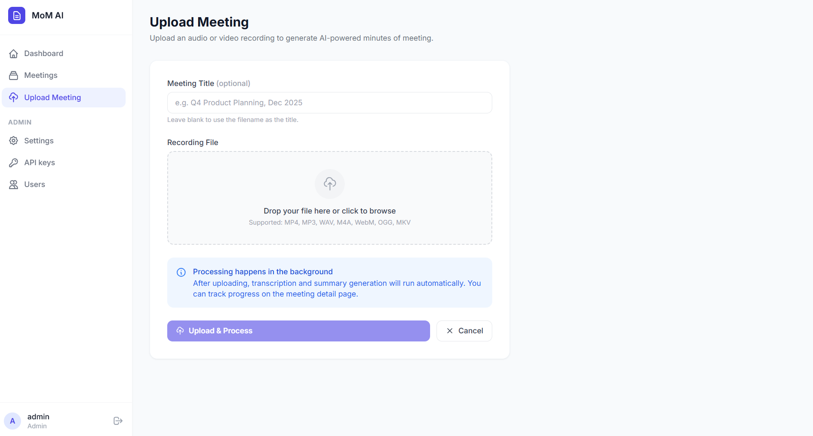
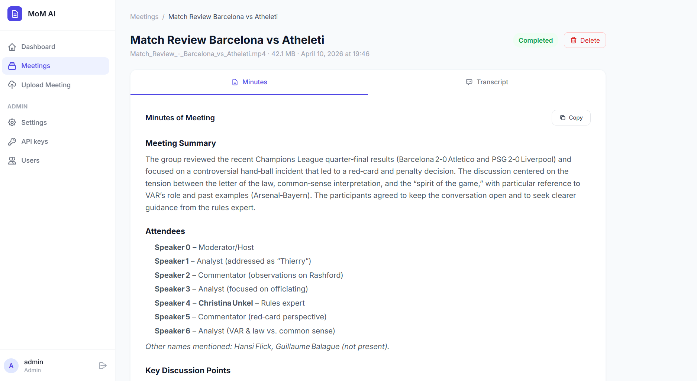

# MoM AI — AI-Powered Minutes of Meeting

---

## Recall.ai - API for meeting recording

If you’re looking for a meeting recording API, consider checking out [Recall.ai](https://www.recall.ai), an API that records Zoom, Google Meet, Microsoft Teams, in-person meetings, and more.

> Sponsored by [Recall.ai](https://www.recall.ai) — The unified API for meeting bots.

---

Upload a meeting recording, get structured minutes back. Transcription and summarisation run on
providers **you** choose — a hosted API, or a model running on your own machine. Everything is
configured from the app itself, and everything it stores stays on your computer.

Runs anywhere Docker runs: Windows, macOS, Linux.

---

## What you get

- **Your choice of transcription** — Deepgram, AssemblyAI, ElevenLabs Scribe, Sarvam AI, any
  OpenAI-compatible endpoint (OpenAI, Groq, Speaches, LocalAI), or Whisper running locally with no API key
- **Your choice of LLM** — any OpenAI-compatible API: OpenAI, OpenRouter, Groq, Together, Fireworks,
  Mistral, Cerebras, Anthropic, Gemini, or Ollama / LM Studio / vLLM on your own hardware
- **Speaker-labelled transcripts** so decisions and action items get attributed correctly
- **Any meeting length** — long recordings are transcribed and summarised in parts, then merged, so
  neither the upload limit nor the model context window caps you
- **Real background jobs** — Celery and Redis, with live progress, an activity log, cancel and retry
- **Configured from the screen** — API keys, models, prompts, retention: no editing files, no restarts
- **Nothing phones home** — no CDNs, no fonts, no telemetry. The only outbound calls are to the AI
  provider you configured
- **Built to run** — health and readiness endpoints, Prometheus metrics, structured logs, automatic
  retention cleanup and stale-job recovery

---

## Screenshots







---

## Quick start

### Docker (recommended)

```bash
git clone https://github.com/inboxpraveen/LLM-Minutes-of-Meeting.git
cd LLM-Minutes-of-Meeting
docker compose up --build
```

Open **http://localhost:5000**. That is the whole setup — no `.env` file, no API keys on disk.

The first screen asks you to create an administrator account. After that, go to **Settings** and add
an LLM endpoint and a transcription provider. Press **Test** on each to confirm they work before you
upload anything.

Want transcription with no API key at all? Build with Whisper included:

```bash
WITH_LOCAL_WHISPER=true docker compose up --build
```

Then choose **Local Whisper** as the speech provider. On Windows PowerShell, use
`$env:WITH_LOCAL_WHISPER="true"` on the line before.

### Without Docker

You need Python 3.10 or newer, [ffmpeg](https://ffmpeg.org/download.html) on your `PATH`, and Redis.

```bash
pip install -r requirements.txt

redis-server                                              # terminal 1
celery -A celery_worker:celery worker -l info             # terminal 2
celery -A celery_worker:celery beat -l info               # terminal 3
python run.py                                             # terminal 4
```

Optional: `pip install -r requirements-local.txt` adds local Whisper.

---

## Choosing providers

Both choices are made in **Settings**. Neither is locked in — switch whenever you like.

### Transcription

| Provider | Speaker labels | Notes |
| --- | --- | --- |
| **Deepgram** | Yes | Fast and accurate. Default model `nova-3`. |
| **AssemblyAI** | Yes | Strong accuracy, straightforward pricing. Default model `universal`. |
| **ElevenLabs Scribe** | Yes | Very good on multilingual audio. Handles stereo recordings per channel. |
| **Sarvam AI** | Yes | Best for Indian languages and code-mixed speech. Uses the batch API, so length is unlimited. |
| **OpenAI-compatible** | No | Anything exposing `/v1/audio/transcriptions`: OpenAI, Groq, or a local server. Long files are split automatically. |
| **Local Whisper** | No | Runs on your machine. No API key, no per-minute cost, nothing leaves the computer. |

### Summarisation

Any OpenAI-compatible chat API. The Settings screen has presets that fill in the base URL for you:

| Provider | Base URL |
| --- | --- |
| OpenAI | `https://api.openai.com/v1` |
| OpenRouter | `https://openrouter.ai/api/v1` |
| Groq | `https://api.groq.com/openai/v1` |
| Together AI | `https://api.together.xyz/v1` |
| Fireworks AI | `https://api.fireworks.ai/inference/v1` |
| Mistral | `https://api.mistral.ai/v1` |
| Cerebras | `https://api.cerebras.ai/v1` |
| Anthropic | `https://api.anthropic.com/v1/` |
| Google Gemini | `https://generativelanguage.googleapis.com/v1beta/openai/` |
| Ollama | `http://localhost:11434/v1` |
| LM Studio | `http://localhost:1234/v1` |

> Running Ollama or LM Studio on your machine while the app is in Docker? Use
> `host.docker.internal` instead of `localhost`.

Use your API key with the matching base URL. An OpenRouter key on OpenAI's URL returns a 401.

---

## Where your data lives

Everything the app stores — the database, uploaded recordings, logs, and the key that encrypts your
API keys — sits in one directory on your machine:

| Platform | Location |
| --- | --- |
| Windows | `%LOCALAPPDATA%\MoM-AI` |
| macOS | `~/Library/Application Support/MoM-AI` |
| Linux | `~/.local/share/MoM-AI` |
| Docker | the `app_data` volume, mounted at `/data` |

Back up that directory and you have backed up the whole application. Set `MOM_DATA_DIR` to move it.

API keys are encrypted at rest with a key generated on first run and stored in the same directory.

---

## Running it properly

| Endpoint | Purpose |
| --- | --- |
| `/healthz` | Liveness. Returns 200 whenever the web process is up. |
| `/readyz` | Readiness. Checks the database, the job queue and ffmpeg. |
| `/metrics` | Prometheus metrics: request rates, job durations, meetings by status. |

**Admin → System** shows the same checks in the browser, plus disk usage, job counts, recent
failures and the tail of the application log.

Optional Celery dashboard:

```bash
docker compose --profile monitoring up
```

Full details are in **[docs/operations.md](docs/operations.md)**.

---

## Documentation

| Guide | Contents |
| --- | --- |
| [docs/configuration.md](docs/configuration.md) | Every setting, and the handful of environment variables |
| [docs/providers.md](docs/providers.md) | Getting a key for each provider, and running models locally |
| [docs/operations.md](docs/operations.md) | Monitoring, backups, upgrades, scaling, reverse proxies |
| [docs/troubleshooting.md](docs/troubleshooting.md) | What to do when something does not work |

---

## Project structure

```
app/
├── __init__.py          App factory, error handlers, Celery wiring
├── config.py            Process-level configuration
├── settings.py          Runtime settings: the schema behind the Settings screen
├── security.py          Local key file, encryption of stored secrets
├── paths.py             OS-specific data directory
├── models.py            User, Meeting, MeetingEvent, SystemConfig
├── health.py            Dependency checks for /readyz and Admin → System
├── logging_setup.py     Structured logging with request ids
├── metrics.py           Prometheus collectors
├── auth/                First-run setup, sign in, account
├── dashboard/           Home
├── meetings/            Upload, list, detail, cancel, retry, download
├── admin/               Settings, users, system
├── api/                 Status polling, health, metrics
├── tasks/               process (the pipeline) and maintenance (retention, stale jobs)
├── providers/
│   ├── llm/             OpenAI-compatible client and chunked summarisation
│   └── speech/          Deepgram, AssemblyAI, ElevenLabs, Sarvam, OpenAI-compatible, local Whisper
├── utils/               ffmpeg helpers, markdown rendering and sanitising
├── static/              Compiled CSS and JS, no CDN
└── templates/           Jinja2 templates
tests/                   pytest suite
```

---

## Development

```bash
pip install -r requirements-dev.txt
pytest
```

The stylesheet at `app/static/css/tailwind.css` is committed so the app needs no build step. If you
change templates, rebuild it:

```bash
npm install && npm run build:css
# or, with no Node installed:
docker run --rm -v "$PWD":/work -w /work node:20-alpine \
  npx -y tailwindcss@3.4.17 -c tailwind.config.js \
  -i app/static/css/tailwind.src.css -o app/static/css/tailwind.css --minify
```

---

## License

[MIT](LICENSE)
